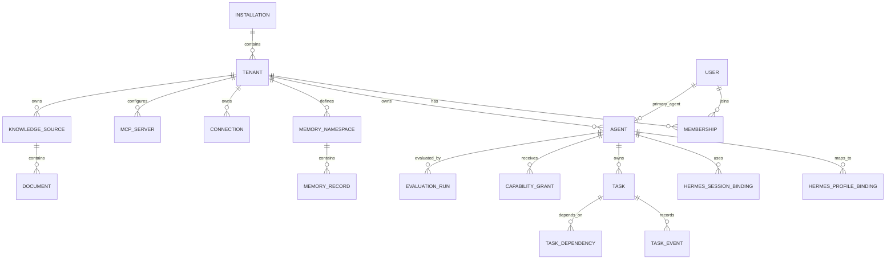

# Agent Harness — Data Model

**Status:** Conceptual schema / Draft v1  
**Database baseline:** PostgreSQL

## 1. Modeling principles

1. Harness owns product data; Hermes owns runtime execution/session internals.
2. Every tenant-owned record is tenant-scoped.
3. Private and shared information have explicit namespaces and grants.
4. Runtime IDs are references, not primary product identities.
5. Task history and security-sensitive changes are auditable.
6. Prefer relational integrity for core state; use JSONB for evolving configuration, not as a substitute for a coherent schema.
7. Store secrets encrypted or as references to a secret store; never store plaintext credentials in ordinary rows.

## 2. Core entity relationships

## 3. Identity and tenancy

### `installations`
- `id` UUID PK
- `name`
- `version`
- `settings` JSONB
- `created_at`, `updated_at`

### `tenants`
- `id` UUID PK
- `installation_id` FK
- `name`
- `tenant_type` (personal, family, business, team, other)
- `status`
- `settings` JSONB
- timestamps

### `users`
- `id` UUID PK
- `email` unique within the appropriate identity scope
- `display_name`
- `auth_subject` / password identity reference
- `status`
- timestamps

### `memberships`
- `id` UUID PK
- `tenant_id` FK
- `user_id` FK
- `role` (owner, admin, member, viewer or extensible policy role)
- `status`
- unique `(tenant_id, user_id)`

### `agents`
- `id` UUID PK
- `tenant_id` FK
- `owner_user_id` nullable FK
- `agent_type` (primary, specialist)
- `name`, `description`
- `identity_config` JSONB (voice/personality/role instructions)
- `status`
- `created_by`
- timestamps

Constraints:
- One active primary agent per user per tenant (partial unique index).
- Specialist agents may be assigned to multiple workflows.
- Agent identity is Harness-owned and mapped into Hermes-supported profile configuration.

## 4. Hermes mapping entities

### `hermes_instances`
- `id` UUID PK
- `installation_id` FK
- `endpoint` / connection reference
- `version_observed`
- `health_status`
- `last_health_check_at`
- `configuration` JSONB (non-secret)
- timestamps

### `hermes_profile_bindings`
- `id` UUID PK
- `agent_id` FK
- `hermes_instance_id` FK
- `hermes_profile_id` (external identifier)
- `desired_config_version`
- `observed_config_version`
- `status`
- unique `(hermes_instance_id, hermes_profile_id)`
- unique `(agent_id, hermes_instance_id)` where one profile per agent is the chosen policy

### `hermes_session_bindings`
- `id` UUID PK
- `agent_id` FK
- `hermes_instance_id` FK
- `hermes_session_id` (external identifier)
- `purpose` (conversation, task, scheduled, evaluation, other)
- `task_id` nullable FK
- `status` (observed lifecycle state)
- `started_at`, `last_seen_at`, `ended_at`
- unique `(hermes_instance_id, hermes_session_id)`

The Harness should not duplicate full Hermes session transcripts by default. Store correlation and product metadata. If transcript indexing is later needed, define retention, source-of-truth and deletion behavior explicitly.

## 5. Contexts and namespaces

### `contexts`
- `id` UUID PK
- `tenant_id` FK
- `name`
- `description`
- `context_type`
- `metadata` JSONB
- timestamps

Contexts are organizational/semantic scopes, not authorization boundaries.

### `memory_namespaces`
- `id` UUID PK
- `tenant_id` FK
- `name`
- `scope_type` (private, agent, shared, tenant)
- `owner_user_id` nullable FK
- `owner_agent_id` nullable FK
- `context_id` nullable FK
- `visibility_policy_id` FK
- `provider_key`
- `provider_namespace_ref`
- `retention_policy`
- timestamps

### `memory_records`
- `id` UUID PK
- `tenant_id` FK
- `namespace_id` FK
- `content` or provider reference, according to storage strategy
- `memory_type`
- `source_type`, `source_ref`
- `provenance` JSONB
- `confidence` numeric nullable
- `valid_from`, `expires_at`
- `status` (candidate, active, corrected, rejected, expired)
- `created_by_agent_id` nullable FK
- timestamps

### `memory_grants`
- `id` UUID PK
- `namespace_id` FK
- `principal_type` (user, agent, role)
- `principal_id`
- `permission` (read, propose, write, administer)
- `granted_by`
- `expires_at`
- timestamps

Do not infer access from agent relationships alone. Enforce grants in the Harness retrieval/write path.

## 6. Knowledge entities

### `knowledge_sources`
- `id` UUID PK
- `tenant_id` FK
- `name`
- `source_type` (upload, folder, connector, URL, other)
- `storage_config` JSONB
- `status`
- timestamps

### `documents`
- `id` UUID PK
- `tenant_id` FK
- `knowledge_source_id` FK
- `title`, `mime_type`
- `object_key`
- `checksum`
- `ingestion_status`
- `metadata` JSONB
- timestamps

### `document_grants`
- `id` UUID PK
- `document_id` FK
- `principal_type`, `principal_id`
- `permission`
- timestamps

Chunks/embeddings should retain `tenant_id`, `document_id` and access metadata so retrieval can filter before returning content. Never retrieve broadly and rely on the model to ignore unauthorized content.

## 7. Orchestration entities (Harness layer over Hermes kanban)

The Harness does not own a parallel task store. Task state, dependencies, events, runs, comments and attachments live in Hermes's kanban (`/root/.hermes/kanban.db`). The Harness stores only a thin wrapper keyed by the kanban task id, plus Harness-owned metadata that kanban does not carry (requester user/agent, acceptance criteria, context refs, approval requirements, tenant enforcement).

### `tasks` (Harness wrapper)
- `id` UUID PK (Harness-side)
- `kanban_task_id` TEXT (FK-like reference to kanban tasks.id; not a DB FK since it crosses stores)
- `tenant_id` FK
- `requester_user_id` nullable FK
- `requester_agent_id` nullable FK
- `owner_agent_id` nullable FK (maps to kanban assignee profile)
- `acceptance_criteria` JSONB or structured child rows
- `context_refs` JSONB (IDs only, each independently authorized)
- `result_summary`
- `created_at`, `updated_at`

Kanban owns: title, body, status, priority, parent/child links (`task_links`), timestamps, runtime fields (worker_pid, claim_lock, session_id, model overrides), consecutive_failures, idempotency_key, completion_contract, goal mode.

### `task_events` (Harness audit)
Harness may append its own audit events (approval decisions, tenant-scoped reads) in its own store; kanban's `task_events` remains the source of truth for task lifecycle. Do not duplicate kanban's event log into the Harness DB.

### `approvals`
- `id` UUID PK
- `tenant_id` FK
- `kanban_task_id` nullable (links to the kanban task being approved)
- `requested_by_agent_id`
- `approver_user_id` nullable FK / approver policy
- `action_type`
- `action_payload` JSONB
- `status` (pending, approved, rejected, expired, cancelled)
- timestamps and decision metadata

All task lifecycle transitions, dependency graphs, retries and dispatch are Hermes kanban's responsibility. The Harness must not write to `kanban.db` directly; mutations go through `hermes kanban` CLI or a supported API.

## 8. Integrations, connections and authorization

### `connections`
- `id` UUID PK
- `tenant_id` FK
- `provider` (github, google, netlify, etc.)
- `display_name`
- `auth_type`
- `secret_ref` (encrypted vault reference, not plaintext)
- `account_subject` / account label
- `scopes` JSONB
- `status`
- timestamps

### `mcp_servers`
- `id` UUID PK
- `tenant_id` FK
- `name`
- `catalog_source`
- `image_or_command_spec` (validated, allowlisted)
- `transport`
- `configuration` JSONB (no plaintext secrets)
- `status`
- `health_status`
- timestamps

### `mcp_server_connections`
- `id` UUID PK
- `mcp_server_id` FK
- `connection_id` FK nullable
- `credential_binding_ref`
- timestamps

### `capability_definitions`
- `id` UUID PK
- `key` unique (e.g. `github.repository.read`)
- `description`
- `risk_level`
- `resource_type`
- `enforcement_mode` (gateway, sandbox, hermes_config, unsupported)
- `metadata` JSONB

### `capability_grants`
- `id` UUID PK
- `tenant_id` FK
- `agent_id` FK
- `capability_key`
- `resource_scope` JSONB
- `connection_id` nullable FK
- `effect` (allow, deny)
- `approval_policy` JSONB
- `constraints` JSONB
- `granted_by`
- `expires_at`
- timestamps

Authorization is evaluated by Harness. A grant describes intent; the enforcement mechanism must be verified for each capability. Unsupported enforcement must not be represented as secure.

### `cli_inventory`
- `id` UUID PK
- `hermes_instance_id` FK or execution-environment reference
- `environment_id`
- `binary_name`
- `binary_path`
- `version`
- `detected_at`
- `authentication_status` (unknown, configured, not_configured; avoid storing tokens)
- `metadata` JSONB
- unique key by environment and binary identity

CLI inventory indicates availability only. It does not automatically grant an agent permission to use the CLI.

## 9. Evaluations and learning

### `evaluation_profiles`
- `id` UUID PK
- `tenant_id` FK
- `agent_id` FK
- `name`
- `version`
- `definition` JSONB
- `status`

### `evaluation_runs`
- `id` UUID PK
- `tenant_id` FK
- `agent_id` FK
- `evaluation_profile_id` FK
- `trigger_type`
- `status`
- `score_summary` JSONB
- `started_at`, `completed_at`

### `learning_proposals`
- `id` UUID PK
- `tenant_id` FK
- `agent_id` FK
- `proposal_type`
- `proposed_change` JSONB
- `evidence_refs` JSONB
- `status` (pending, approved, rejected, promoted, rolled_back)
- `reviewed_by`
- timestamps

## 10. Audit and system events

### `audit_events`
- `id` UUID PK
- `installation_id` FK
- `tenant_id` nullable FK
- `actor_type`, `actor_id`
- `action`
- `target_type`, `target_id`
- `outcome`
- `metadata` JSONB
- `created_at`

Record at minimum:
- User/role/tenant changes.
- Agent identity and profile configuration changes.
- Memory grants and sharing changes.
- Credential creation, rotation, revocation and access events (never credential values).
- MCP server changes and tool policy changes.
- Approval decisions.
- Sensitive tool actions where observable.
- Backup/restore and upgrade actions.

## 11. Database enforcement

- Use foreign keys and unique constraints for identity and mappings.
- Consider PostgreSQL row-level security as defense in depth, not the only authorization layer.
- Tenant ID must be supplied from authenticated server context, not trusted from arbitrary client payloads.
- Every memory/knowledge retrieval must authorize before returning content.
- Use transactions for task state changes plus event insertion.
- Use an outbox table for reliable event publication.
- Add indexes for tenant, owner, status, updated time, namespace and task queue access.
- Define retention/deletion semantics before general availability.
