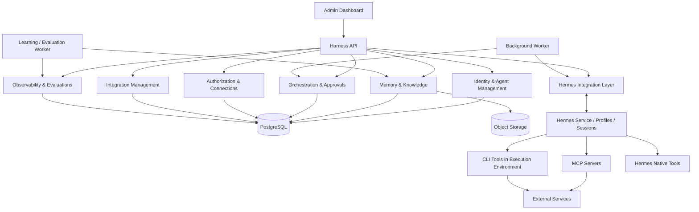

# Agent Harness — System Architecture

**Status:** Architecture baseline / Draft v1  
**Runtime strategy:** Hermes-only for the foreseeable future

## 1. Architectural summary

The Agent Harness is a control, identity, memory, orchestration and governance layer around Hermes.

It is not a generic runtime abstraction platform. Hermes is the only supported execution runtime in the initial architecture. Avoid building runtime adapters for hypothetical alternatives.

### Ownership boundary

| Concern | Owner |
|---|---|
| Agent identity, tenant/user relationship | Harness |
| Long-term memory policy and namespaces | Harness |
| Knowledge/document permissions | Harness |
| Cross-agent tasks, dependencies, approvals | Harness |
| Agent evaluations and learning governance | Harness |
| Connections and credential ownership | Harness |
| MCP server lifecycle and access policy | Harness |
| Hermes profiles and sessions | Hermes, mapped/managed by Harness |
| Agent loop, model interaction, tool invocation | Hermes |
| Terminal, browser, filesystem and process tools | Hermes |
| CLI invocation | Hermes terminal |
| MCP client and MCP tool invocation | Hermes |
| Container isolation and host resources | Infrastructure |

The Harness may create or update Hermes configuration through supported interfaces, but it should not fork or reimplement Hermes functionality.

## 2. Logical architecture



## 3. Application modules

### 3.1 API and domain modules

Use a NestJS modular monolith with explicit domain boundaries:

- `installation`: setup, settings, feature/configuration state.
- `tenants`: tenant lifecycle and tenant-scoped configuration.
- `users`: human accounts, roles and membership.
- `agents`: agent identity, role, ownership, primary-agent assignment.
- `hermes-integration`: supported Hermes APIs/configuration, profile/session mapping, lifecycle and health.
- `memory`: memory records, namespaces, provider interface and policy.
- `knowledge`: documents, ingestion, indexing, retrieval and access checks.
- `orchestration`: tasks, dependencies, assignments, state transitions and dispatch.
- `authorization`: policies, capability grants, approvals and decision records.
- `integrations`: MCP catalog, server lifecycle, connections and CLI inventory.
- `models`: allowed model/provider configuration and policy where needed, while Hermes performs model interaction.
- `evaluations`: evaluation definitions, runs, results and regression tracking.
- `observability`: events, audit, execution correlation, costs and health.
- `secrets`: encrypted secret references and rotation metadata.
- `admin`: dashboard-facing aggregation and administrative operations.

Modules communicate through explicit application services/events, not by reaching into one another's tables or internal classes.

### 3.2 Processes

Initial deployment can use one repository and one build artifact with distinct process entrypoints:

- `api`: HTTP API and admin-facing operations.
- `worker`: task dispatch, event handling, retries and Hermes lifecycle jobs.
- `learning-worker`: memory proposal processing and evaluation jobs.
- `dashboard`: React/Vite static app served through the reverse proxy.
- `postgres`: structured state.
- `object-storage`: optional local S3-compatible service or external storage.
- `hermes`: Hermes service/runtime deployment.
- `mcp-*`: dynamically managed, approved MCP server containers.

These are deployment processes, not a commitment to independently deployable microservices.

## 4. Hermes Integration Layer

This is the only runtime integration layer required initially.

Responsibilities:
- Discover and validate the configured Hermes installation/version.
- Create and manage Harness-to-Hermes profile mappings using supported Hermes interfaces.
- Associate Harness agents with Hermes profiles.
- Create/locate/manage Hermes sessions using supported session functionality.
- Apply Harness-approved configuration to Hermes profiles and MCP access.
- Read runtime health and relevant execution/session metadata.
- Correlate Hermes activity with Harness users, agents and tasks.
- Detect configuration drift and reconcile desired versus observed state.
- Handle restart/reconnect and idempotent lifecycle operations.

It must not:
- Reimplement the agent loop.
- Implement a second terminal/browser/filesystem.
- Replace Hermes session storage.
- Assume undocumented database schemas are stable.
- Treat a Hermes profile as the complete source of truth for Harness identity or permissions.

Prefer documented APIs, CLI commands or supported extension points. If a required capability is not exposed, document the gap and choose the least invasive integration rather than directly mutating internal Hermes storage.

## 5. Agent, profile and session mapping

Harness Agent is the durable product entity. Hermes profile/session identifiers are external runtime references.

Suggested mapping:

```text
HarnessAgent
  id
  tenant_id
  person_id?              # owner for primary agent
  agent_type              # primary | specialist
  display_name
  identity_config
  policy_id
  status

HermesProfileBinding
  id
  harness_agent_id
  hermes_instance_id
  hermes_profile_id
  observed_version
  desired_config_version
  observed_config_version
  status

HermesSessionBinding
  id
  harness_agent_id
  hermes_session_id
  session_purpose
  linked_task_id?
  created_at
  last_seen_at
```

Hermes remains authoritative for its own session lifecycle and session data. Harness stores mappings and product-level associations. Do not duplicate transcript/session internals unless required for indexing or audit and permitted by the integration contract.

## 6. Data and event flow

### User request / task

1. Request reaches the person's primary agent through a supported Hermes interaction surface.
2. Harness provides authorized identity, memory, knowledge and relevant task context through its integration mechanisms.
3. Hermes performs reasoning and tool execution.
4. When delegation is needed, the agent uses a Harness-owned orchestration capability/API.
5. Harness creates durable task records and assigns a specialist.
6. Worker dispatches the task to the specialist's Hermes profile/session.
7. Specialist submits result/evidence.
8. Harness records state and emits an event.
9. Primary agent receives the result through the supported integration mechanism and reports it.

The exact message handoff mechanism must be validated against Hermes's supported interfaces. Do not assume a particular webhook or internal event API exists until verified.

### Memory flow

1. Hermes interaction/task outcome produces a memory candidate or explicit memory operation.
2. Harness checks tenant, owner, scope, provenance and policy.
3. Candidate is stored through the configured memory provider.
4. Retrieval checks access policy before content is returned to an agent.
5. Learning/evaluation jobs may recommend changes; promotion is governed and auditable.

## 7. Storage architecture

- PostgreSQL: tenants, users, agents, mappings, policies, tasks, approvals, integration metadata, evaluation metadata, audit/events and references.
- Object storage: uploaded documents, generated artifacts and large binary assets.
- Memory provider: behind a Harness-owned interface; Mnemosyne is an initial adapter, not the domain model.
- Vector retrieval: start with PostgreSQL/pgvector if suitable; avoid introducing a separate vector database without measured need.
- Hermes storage: owned by Hermes. Persist it using its supported deployment/storage configuration.

## 8. Deployment topology

Docker Compose is the initial packaging contract for both local and VPS installations.

Recommended logical services:
- reverse proxy / HTTPS
- dashboard
- API
- worker
- learning worker
- PostgreSQL
- object storage (optional)
- Hermes
- approved MCP containers

Use persistent volumes for PostgreSQL, Hermes-supported persistent data and local object storage. Never remove volumes as part of an ordinary upgrade.

Do not give the API unrestricted Docker socket access. Use a narrowly scoped container-management component/proxy or a constrained deployment mechanism with image allowlists, network rules and resource limits.

## 9. Resilience and consistency

- Use desired-state records for Harness-managed Hermes configuration.
- Reconciliation jobs compare desired configuration with observed runtime state.
- Lifecycle operations must be idempotent.
- Use an outbox/event pattern for reliable task and integration events.
- Use bounded retries with dead-letter/error states.
- On Hermes restart, re-discover profiles/sessions and restore mappings without creating duplicates.
- On Harness restart, queued tasks remain durable in PostgreSQL.
- If Hermes is unavailable, tasks remain queued or transition to blocked; do not silently mark them complete.
- Detect and surface drift rather than silently overwriting unknown runtime changes.

## 10. Security boundaries

- Tenant ID is part of every tenant-owned record and query boundary.
- Private memory and credentials are isolated by owner and explicit grants.
- Hermes runtime access is constrained by profile configuration and execution environment.
- MCP access is restricted by per-agent server/tool policy and, where needed, a controlled gateway.
- CLI tools are executed by Hermes terminal inside the relevant sandbox; the Harness inventories/provisions them and controls environment/credentials.
- Secrets are not copied into broad agent prompts or shared files.
- Audit privileged changes and sensitive operations.
- UI visibility is not authorization.

## 11. Initial repository layout

```text
agent-harness/
  apps/
    api/
    worker/
    learning-worker/
    dashboard/
  packages/
    domain/
    identity/
    agents/
    hermes-integration/
    memory/
    knowledge/
    orchestration/
    authorization/
    integrations/
    evaluations/
    observability/
    secrets/
    shared/
  adapters/
    memory-mnemosyne/
    storage/
  infrastructure/
    docker/
    migrations/
    scripts/
  docs/
```

This is a starting boundary map, not a mandate to create a package for every small concept. Keep domain boundaries clear while avoiding premature fragmentation.
